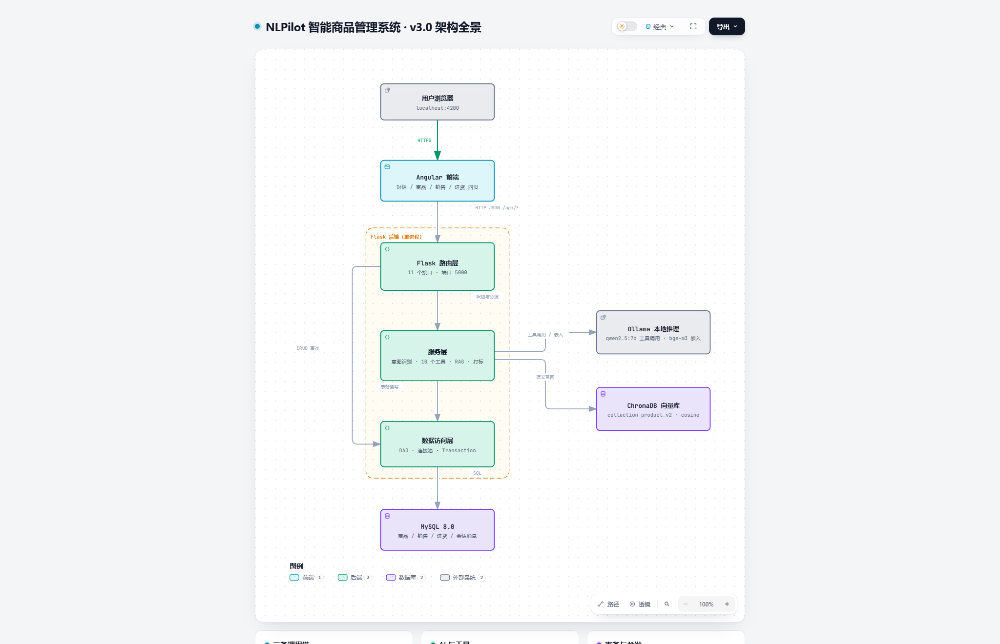

# NLPilot · 智能商品管理系统

> 用一句中文完成商品管理。基于本地 7B 模型做意图识别与工具调用，叠加向量检索（RAG）承载语义查询。

**v3.0** ｜ Python 3.12 · Flask 3.1 · MySQL 8.0 · Angular 22 · Ollama（qwen2.5:7b + bge-m3）

📊 **[架构全景图（交互式）](docs/architecture-v3.html)** ｜ 静态预览：[PNG](docs/architecture-v3.png)

---

## 当前状态

- **版本**：v3.0
- **成熟度**：可演示 / Demo

### 验收实测（MySQL 8.0.46 + Ollama qwen2.5:7b + bge-m3）

| 验收项 | 结果 |
|---|---|
| AI 工具选择准确率 | **14/14 = 100%** |
| 幻觉（编造"已完成"） | **0/6** |
| 正常问答误伤 | **0/8** |
| 参数校验（布尔 / 边界） | **9/9 正确** |
| HTTP 状态码 | **6/6 正确** |
| 销售事务原子性（故障注入） | ✅ 两表均无残留 |
| 并发超卖（10 线程抢 5 库存） | ✅ 恰好成功 5 次，库存归零 |
| RAG 场景词召回 | ✅ **6/7** |
| RAG 无关查询拦截 | ✅ **4/4** |
| 新增商品自动打标 | ✅ AI 路径 + HTTP 路径均生效 |
| 前端构建 / 单元测试 | ✅ 构建通过 · 1 passed |

---

## 这个项目是什么

一个**用自然语言操作商品库**的管理系统。不点按钮，直接说话：

```
你：查一下 iPhone15 的库存
你：卖了 2 个 iPhone15
你：能听歌的有什么          ← 名字里没有"听歌"，靠语义检索命中
你：适合办公的推荐一下
你：这周的销售情况怎么样
```

系统把这句话交给本地模型（qwen2.5:7b），由模型决定调哪个工具、传什么参数，
再由后端执行真正的数据库操作。

**危险操作会先弹确认框**：

```
你：删除 小米手环8
系统：（弹窗）即将删除商品「小米手环8」，确认吗？
你：确定  →  已删除：小米手环8
```

---

## 核心能力

### ✅ 稳定支持

| 能力 | 示例 |
|---|---|
| 查询商品（按名） | "查一下 iPhone15 的库存"、"有哪些商品" |
| **语义查询（按意思）** | **"能听歌的"、"适合办公的"、"出差带着充电的"** |
| 新增商品（自动打标） | "新增商品 蓝牙音箱 价格 199 库存 30" |
| 修改价格 / 库存 | "把 iPhone15 的价格改成 5799" |
| 删除商品（二次确认） | "删除 小米手环8" |
| 打折（二次确认） | "iPhone15 打八折" |
| 记录销售 / 进货 | "卖了 2 个 iPhone15"、"进货 10 个 机械键盘K8" |
| 查询销售 / 进货记录 | "最近的销售记录"、"昨天卖了什么" |
| 销售统计 | "这周的销售情况怎么样" |

### ⚠️ 有限支持

- **集合查询**（"有哪些配件""库存大于 50 的"）：`query_products` 目前只接受 `name`
- **多轮上下文**（"给它打八折"）：模型经常退化成"再查一次商品"
- **口语化的"补"**：说"补货 XX 5 个"可以，说"补 5 个 XX"会被守卫拦下
- **商品名改写**：模型可能把"机械键盘K8"传成"K8"

### ❌ 不支持

- 撤销 / 回滚已记录的销售与进货
- 用户登录与权限控制
- 政策类问答（退货、发票、物流）—— 知识库里没有数据

---

## 架构总览



```
用户浏览器
   ↓ HTTPS
Angular 前端（对话 / 商品 / 销售 / 进货）
   ↓ HTTP JSON /api/*
┌────────────── Flask 后端（单进程）──────────────┐
│  Flask 路由层          11 个接口 · :5000         │
│        ↓ 识别与分发                              │
│  服务层   意图识别 · 10 个工具 · RAG · 打标        │
│        ↓ 事务读写                                │
│  数据访问层          DAO · 连接池 · Transaction    │
└──────────────────────────────────────────────────┘
   ↓ SQL                              ↘ 语义召回
MySQL 8.0                          ChromaDB 向量库
（唯一事实来源）                    （只负责找 id）
```

**旁挂外部服务**：Ollama —— `qwen2.5:7b` 负责工具调用与打标，`bge-m3` 负责向量嵌入。

### 三条互不重叠的调用链

| 链路 | 入口 | 路径 |
|---|---|---|
| **AI 对话** | `POST /api/chat` | 路由 → 意图识别 → 工具 → DAO |
| **REST 直连** | `GET/POST /api/products`、`/api/sales` | 路由 → DAO（**跳过 AI 层**） |
| **二次确认** | `POST /api/chat/confirm` | 路由 → DAO |

> 容易忽略的一点：`/api/products`、`/api/sales` 这类接口**不经过 AI**，直接调 DAO。

---

## 关键技术设计

### 1. 幻觉守卫：模型没调工具就默认不信任

7B 模型有个危险行为：**不调用工具，却用文字声称"已经完成"**，甚至编造库存数字。
实测出现过："记录了一笔 iPhone15 的销售。您卖出了 2 台，当前剩余 143 台。" —— 而数据库毫无变化。

`backend/routes/chat_routes.py`：

```python
if call.get("is_txt") and not call.get("tool"):
    if any(h in msg for h in SAFE_HINTS):      # 确认是闲聊/查询
        return success(...)                     # 原样返回
    return success(...)                         # 否则一律报"未执行任何操作"
```

**白名单放在"闲聊"这一侧**（`SAFE_HINTS`），而不是"写操作"那一侧。
因为闲聊是封闭集合（你好/谢谢/天气…），写操作是开放集合
（卖掉/出货/清掉/处理掉/降下来/记一笔…），枚举不完。

### 2. 事务边界：DAO 不管事务，业务层统一管

"写销售记录"和"扣库存"必须同生共死。早期写法是两个 DAO 各开连接、各 `commit()`，
任一步失败就会留下半个状态。

现在：

```python
with Transaction() as conn:                     # 事务从这里开始
    with conn.cursor() as cur:
        cur.execute("SELECT ... FOR UPDATE")    # 读库存 + 行锁
        sales_dao.record_sale(..., cursor=cur)  # 不 commit
        cur.execute("UPDATE product_lists ...")  # 同一游标 = 同一事务
# 正常退出 COMMIT；抛异常 ROLLBACK；无论如何归还连接
```

DAO 因此支持"借用"：传 `cursor=` / `conn=` 时不 commit、不 close，控制权交给调用方。

**实测（故障注入，让扣库存失败）**：

```
sales 0 → 0   库存 145 → 145   ✅ 已回滚，无孤儿记录
```

### 3. 行级锁：`SELECT ... FOR UPDATE` 防并发超卖

"读库存 → 判断 → 写库存"之间隔着两次网络往返，两个请求会读到同一个值，双双判断"够卖"。
事务内加行锁后，后到的请求会阻塞等待，拿到锁时读到的是已更新的库存。

**实测（10 线程同时卖同一商品，库存只够 5 个）**：

```
成功 5 次，失败 5 次   sales=5   库存=0   ✅ 未超卖
```

> 前提：`FOR UPDATE` 必须在事务里才有效（本项目 `autocommit=False`）。

### 4. 数据质量自检：缺标签是静默的

打标是 best-effort（失败只打印一句）。这意味着 Ollama 抖一下、或手工插一条数据，
就会留下"没有描述"的商品——**它不报错，只是悄悄失去语义检索能力**。

`backend/app.py` 的启动自检：

```
[自检] ✅ 10/10 个商品都有描述，语义检索完整
```

缺失时打印警告 + 补全命令，但**绝不自动补标**（否则启动会被 LLM 拖垮，
且 Ollama 一挂后端就起不来）。

`GET /api/health` 同时暴露覆盖率：

```json
{"data_quality": {"products": 10, "with_description": 10},
 "rag": {"ok": true, "vectors": 10}}
```

---

## RAG 链路详解

### 定位：它是兜底，不是主路径

```
① 结构化查询（SQL LIKE）   —— 99% 的情况走这里，0.13~0.73 ms
   ↓ 查不到
② 语义召回（RAG）          —— 只有 SQL 干不了才触发，约 230 ms
   ↓ 距离超过阈值
③ 明确说"没找到"           —— 绝不编造
```

**为什么 RAG 只做兜底**：实测 200 个商品，SQL 查名字 **0.13~0.73ms**，
向量检索 **211~353ms** —— 慢 **343~2628 倍**。用向量匹配商品名是纯粹的浪费。

### 写入路径：索引怎么建起来

```
新增商品（AI 或 HTTP 路径）
   ↓
① product_dao.insert_product()         纯 SQL、先提交（商品一定建成）
   ↓
② enrich_services.tag(name)            qwen2.5:7b 生成三件套
      → {category:"耳机", tags:["通勤","降噪"],
         description:"无线蓝牙耳机，通勤听歌都合适"}
   ↓
③ product_dao.save_enrichment()        写回 MySQL 三个字段
   ↓
④ rag_services.upsert_product(row)     建索引
      → _doc() 拼接："AirPodsPro 耳机 通勤 降噪 无线蓝牙耳机，通勤听歌都合适"
      → bge-m3 变 1024 维向量
      → Chroma upsert
```

**三条纪律**：

| 纪律 | 原因 |
|---|---|
| **先打标、再索引** | 反了就索引里只有名字，描述检索对它永远失效 |
| **打标不能阻塞/回滚新增** | Ollama 挂了也必须能加商品（加商品与 AI 无关） |
| **打标在事务提交之后** | 否则 LLM 的几秒钟会把事务和连接一起占住 |

批量补标（历史数据 / 导入数据）：

```bash
cd backend && python scripts/auto_tag.py
```

逻辑相同，只是源头是 `WHERE description IS NULL OR description = ''`，
并且会**同步向量库**（否则 MySQL 补好了、索引还是旧的）。

### 读取路径：一次查询的完整旅程

以「**能听歌的**」为例：

```
① nlu_service.recognize()
   qwen2.5:7b 从工具表里选出 query_products(name="能听歌的")
      ↓
② tools.query_products("能听歌的")
      ├─ SQL: WHERE name LIKE '%能听歌的%'  → 0 条   ✗
      ↓
③ rag_services.search_products("能听歌的", top_k=3)
      ├─ bge-m3 把 query 变向量        ~156 ms
      ├─ Chroma cosine 检索            ~76 ms
      └─ 返回 [("2", 0.446), ("11", 0.61), ("3", 0.62)]
      ↓
④ 阈值过滤 distance <= 0.53 → [("2", 0.446)]
      ↓
⑤ product_dao.get_by_ids([2])
      回查 MySQL 拿真实价格、库存、描述
      → {id:2, name:"AirPodsPro", price:1899, stock:80, ...}
      ↓
⑥ 返回 {"ok":true, "count":1, "data":[...], "is_rag":true}
      ↓
⑦ 前端渲染："共 1 条：· AirPodsPro ¥1899.00 库存 80"
```

### 索引里存了什么

```
Chroma collection: product_v2     度量：cosine
每条记录：
  id        : "2"
  document  : "AirPodsPro 耳机 无线 降噪 通勤 无线蓝牙耳机，通勤听歌都合适"
  embedding : 1024 维向量
  metadata  : {"category": "耳机"}
```

文档拼接规则：

```python
def _doc(p):
    parts = [p["name"], p["category"], p["tags"].replace(",", " "), p["description"]]
    return " ".join(x for x in parts if x and x.strip())
```

**为什么四段都要拼**：名字保证精确命中距离≈0；品类和标签补上用户可能说的词；
描述承载"能听歌的""适合办公的"这类真正的**意图**。

### 为什么价格库存不放进向量库

实测过：把 `price/stock` 作为 metadata 存进 Chroma，卖 30 个之后：

| 来源 | 价格 | 库存 |
|---|---|---|
| MySQL（真实） | 5999.00 | **115** |
| RAG（快照） | 5999.00 | **145** ← 过期 |

**向量库只负责"找到 id"，MySQL 才是唯一事实来源。**

### 泛化的三层来源

```
第 1 层  SQL LIKE         覆盖"用户说的词在名字里"      快、准、可解释
   ↓ 查不到
第 2 层  向量语义召回      覆盖"描述里出现过相近意思"     中速、能容错
   ↓ 距离 > 阈值
第 3 层  明确说"没找到"    覆盖"真的没有"               安全，绝不编造
```

---

## 实测数据

### 检索性能

| 操作 | 耗时 |
|---|---|
| MySQL LIKE 查名字 | **0.13 ~ 0.73 ms** |
| MySQL FULLTEXT（ngram） | 0.14 ~ 1.62 ms |
| RAG 检索（bge-m3 + Chroma） | **约 230 ms**（嵌入 156 ms + 检索 76 ms） |
| 索引构建 | 约 230 ms / 条 |
| 新增商品（含 LLM 打标） | 约 17 s（两个模型换入换出，见已知局限） |

### 语义召回效果（10 个真实商品）

| 查询 | 召回结果 |
|---|---|
| 能听歌的 | AirPodsPro, iPadAir, 12 |
| 适合办公的 | MacBookAirM3, 罗技鼠标M590, 机械键盘K8 |
| 跑步运动戴的 | AirPodsPro, 小米手环8 |
| 出差充电用的 | MacBookAirM3, 罗技鼠标M590, 充电宝20000mAh |
| 送礼 | iPhone15, 充电宝20000mAh |
| 今天天气怎么样 / 帮我订机票 / 你是谁 / asdfghjkl | **全部 0 条（被阈值拦截）** |

### 阈值标定（cosine 距离）

```
相关查询： 0.204 ~ 0.527
无关查询： 0.539 ~ 0.690
阈值 0.53 卡在两者之间，但间隙只有约 0.01~0.02。
```

---

## 快速开始

### 1. 准备环境

需要：**MySQL 8.0**、**Ollama**、**Python 3.12**、**Node.js + npm**。

```bash
ollama pull qwen2.5:7b        # 约 4.4 GB，工具调用与打标
ollama pull bge-m3            # 约 1.2 GB，向量嵌入
ollama serve
```

### 2. 建数据库

```bash
mysql -u root -p -e "CREATE DATABASE nlpilot CHARACTER SET utf8mb4;"
mysql -u root -p nlpilot < database/init.sql
```

> 如果 `product_lists` 还没有 `category / tags / description` 三列，需要先补：
> ```sql
> ALTER TABLE product_lists
>   ADD COLUMN category    VARCHAR(32)  DEFAULT NULL,
>   ADD COLUMN tags        VARCHAR(255) DEFAULT NULL,
>   ADD COLUMN description TEXT         DEFAULT NULL;
> ```

### 3. 配置环境变量

```bash
cd backend
copy .env.example .env        # Linux/macOS: cp
```

编辑 `backend/.env`，**至少改密码**：

```ini
DB_HOST=127.0.0.1
DB_PORT=3306
DB_USER=root
DB_PASSWORD=你的MySQL密码
DB_NAME=nlpilot

OLLAMA_HOST=http://127.0.0.1:11434
OLLAMA_MODEL=qwen2.5:7b

FLASK_PORT=5000
FLASK_DEBUG=true
```

### 4. 启动后端

```bash
cd backend
python -m venv .venv
.venv\Scripts\activate         # Linux/macOS: source .venv/bin/activate
pip install -r requirements.txt
python app.py
```

首次启动会自动建向量索引，正常输出：

```
[自检] ✅ 10/10 个商品都有描述，语义检索完整
 * Running on http://0.0.0.0:5000
```

验证：

```bash
curl http://127.0.0.1:5000/api/health
# {"data_quality":{"products":10,"with_description":10},"rag":{"ok":true,"vectors":10},...}
```

**如果自检提示有商品缺描述**，跑一次补标：

```bash
cd backend && python scripts/auto_tag.py
```

### 5. 启动前端

```bash
cd frontend
npm install
npm start
```

打开 **http://localhost:4200**。跑测试用 `npm test`。

> 前端请求地址写死在 `frontend/src/app/services/api.service.ts` 的 `private base`，
> 改了后端端口要同步改这里。

---

## 项目结构

```
NLPilot - Smart Admin/
├── backend/
│   ├── app.py                     # Flask 入口 + 启动自检 + /api/health
│   ├── config.py                  # 读 .env
│   ├── db.py                      # DBUtils 连接池 + Transaction 事务上下文
│   ├── response.py                # 统一响应格式（HTTP 状态码 = 业务码）
│   ├── dao/                       # 数据访问层（SQL 全参数化）
│   │   ├── product_dao.py         #   商品 CRUD + save_enrichment + get_by_ids
│   │   ├── sales_dao.py           #   销售记录（支持借用连接/游标）
│   │   └── purchases_dao.py       #   进货记录（同上）
│   ├── services/
│   │   ├── nlu_service.py         #   调 Ollama 选工具 + 3 次重试 + 泄漏检测
│   │   ├── product_service.py     #   按 AI 决策分发到工具
│   │   ├── tools.py               #   10 个工具（含事务 + 行锁）
│   │   ├── enrich_services.py     #   LLM 打标：品类 / 标签 / 描述
│   │   └── rag_services.py        #   向量库：_doc / upsert / search / delete
│   ├── routes/                    # 接口层
│   │   ├── chat_routes.py         #   /api/chat、/api/chat/confirm（幻觉守卫）
│   │   ├── product_routes.py      #   /api/products
│   │   ├── sales_routes.py        #   /api/sales
│   │   └── purchases_routes.py    #   /api/purchases
│   ├── scripts/
│   │   └── auto_tag.py            # 批量补标（同步 MySQL + 向量库）
│   └── prompts/system_prompt.py   # 系统提示词
├── frontend/src/app/
│   ├── app.routes.ts              # 4 个路由：chat / products / sales / purchases
│   ├── services/api.service.ts
│   ├── models/product.model.ts
│   └── components/                # chat / product-list / sales-list / purchases-list / navbar
├── database/init.sql              # 建表脚本
├── docs/
│   ├── architecture-v3.html       # 架构全景图（交互式，推荐）
│   └── architecture-v3.png        # 静态预览
└── README.md
```

---

## API 一览

| 方法 | 路径 | 说明 |
|---|---|---|
| GET | `/api/health` | 健康检查 + 数据质量 + 向量库状态 |
| GET | `/api/products?name=` | 查询商品（`name` 模糊匹配，可省略） |
| POST | `/api/products` | 新增商品 `{name, price, stock}`（自动打标） |
| PUT | `/api/products/<name>` | 修改 `{price?, stock?}` |
| DELETE | `/api/products/<name>` | 删除商品（同步删除向量） |
| GET | `/api/sales?name=&days=` | 查询销售记录 |
| POST | `/api/sales` | 记录销售 `{name, quantity, unit_price?}` |
| GET | `/api/sales/summary?name=&days=` | 销量汇总 |
| GET | `/api/purchases?name=&days=` | 查询进货记录 |
| POST | `/api/chat` | 自然语言入口 `{message, history}` |
| POST | `/api/chat/confirm` | 二次确认 `{action, target, data}` |

**响应格式**（HTTP 状态码与 `code` 字段一致）：

```json
// 成功：HTTP 200
{ "code": 200, "message": "success", "data": {} }

// 失败：HTTP 400 / 404 / 409 / 500
{ "code": 404, "message": "商品 iPhone15 不存在", "data": null }
```

前端 `chat.ts` 的 `_handleError` 按 HTTP 状态码分类提示，所以后端必须返回真实状态码。

**`/api/chat` 的 `is_rag` 字段**标识这次结果是否来自语义召回：

```json
{ "ok": true, "count": 1, "is_rag": true,
  "data": [{ "id": 2, "name": "AirPodsPro", "price": "1899.00", "stock": 80 }] }
```

---

## 已知局限

### 🟠 影响体验

| 问题 | 说明 |
|---|---|
| **新增商品约 17 秒** | 打标调 qwen2.5:7b、建索引调 bge-m3，两个模型来回换入换出。给 Ollama 调用加 `keep_alive` 可降到 1~2 秒 |
| **阈值很脆** | 相关 ≤0.527、无关 ≥0.539，间隙只有 0.01~0.02，偶尔误召或漏召 |
| **只返回 top_k=3** | "全部配件"这种集合查询做不到，需要结构化过滤 |
| **`category` 值不规范** | LLM 会漂移出"鼠标""充电宝""平板电脑"，导致 `WHERE category='配件'` 查不到 |

### 🟡 功能缺口

| 问题 | 说明 |
|---|---|
| `query_products` 只能按名字查 | 无法表达"有货的""低于 200 的""品类=耳机" |
| 商品名含 `/` 无法改删 | 路由 `/api/products/<name>` 不匹配斜杠 |
| 无分页 / 无 `LIMIT` | 500 条销售记录会一次全返回 |
| 对话不持久化 | `conversations` / `messages` 表建了但零引用，刷新即丢 |
| 进货页文案是复制的 | `purchases-list.html` 标题写"销售记录"，selector 与销售页相同 |
| 测试覆盖低 | 前端仅 1 个 spec，后端无自动化测试；`test_pool.py` 是实验残留 |

---

## 版本历史

- **v0.1**：基础 CRUD + prompt + JSON 意图识别
- **v0.2**：Function Calling + 销售 / 进货模块
- **v0.3**：重试机制 + tool_call 泄漏检测 + 幻觉拦截（关键词白名单）
- **v0.4**：健壮性修复
  - 修复 `POST /api/sales` 缺 `name` 时的 500 崩溃
  - 修复 `PUT /api/products` 的 `stock` 校验恒真错误（曾导致改库存完全失效）
  - 补齐全部布尔值校验（`isinstance(x, bool)`）
  - `error()` 返回真实 HTTP 状态码，激活前端错误处理
  - 幻觉守卫改为 `SAFE_HINTS` + 默认不信任
- **v0.5**：事务与并发
  - 新增 `db.Transaction` 事务上下文管理器
  - DAO 支持借用外部连接 / 游标，事务边界上移到业务层
  - 「写记录 + 改库存」改为单事务，失败整体回滚
  - 库存读取加 `SELECT ... FOR UPDATE` 行锁，消除并发超卖
- **v3.0（当前）**：接入 RAG
  - 新增 `enrich_services`：LLM 自动生成品类 / 标签 / 描述
  - 新增 `rag_services`：ChromaDB 向量库 + bge-m3 嵌入
  - `query_products` 增加语义兜底（SQL 查空 → 向量召回 → 回查 MySQL）
  - 新增 / 删除商品自动同步索引；`scripts/auto_tag.py` 支持批量补标
  - 启动自检 + `/api/health` 暴露数据完整度
  - 优化系统提示词：参数已给出时不再反复追问（工具选择 11/14 → 14/14）
  - 新增架构全景图 `docs/architecture-v3.html`

---

## 后续计划

**近期（提升可用性）**

1. 给 Ollama 调用加 `keep_alive="30m"`，把新增从 17 秒降到 1~2 秒
2. `query_products` 增加 `category` / `in_stock` / `max_price` / `sort` 参数，支持集合查询
3. `category` 写入时归一化（别名映射），让"有哪些配件"可用 SQL 过滤
4. 重新标定阈值（或改为"top-1 距离 + LLM 复核"两段式）

**中期（补质量）**

5. 补测试：事务回滚、布尔校验、幻觉守卫、RAG 阈值
6. 商品名含 `/` 改为请求体传名字
7. 查询接口加分页 `LIMIT`
8. 对话持久化（用上已有的 `conversations` / `messages` 表）

**远期（扩展能力）**

9. 知识库问答：退换货 / 物流 / 发票政策（RAG 的真正主场，独立于商品表）
10. 相似商品推荐（复用描述向量做 kNN）
11. 别名表（"苹果手机" → iPhone15），比 embedding 更精确可解释

---

## 常见问题

**Q：后端启动就崩，报 `Can't connect to MySQL server` / `OperationalError (2003)`**

`backend/db.py` 在**模块导入时**就用 `mincached=2` 建连接池，
所以 MySQL 没启动后端根本起不来，且报错栈全是连接池内部调用。
请先确认 MySQL 已启动、`.env` 密码正确。

**Q：对话报错或没反应**

Ollama 没启动，或模型没拉。检查：

```bash
curl http://127.0.0.1:11434/api/tags
ollama pull qwen2.5:7b && ollama pull bge-m3
```

**Q：启动自检提示"有商品缺描述"**

说明这些商品无法被语义检索到（只能按名字查）。跑一次补标：

```bash
cd backend && python scripts/auto_tag.py
```

脚本会同时更新 MySQL 和向量库。

**Q：AI 回"我没能理解你的操作意图，请换一种说法重试（未执行任何操作）"**

这是**幻觉守卫生效**，不是 bug。说明模型没有调用工具（可能想用文字请求确认，
或者不认得你的说法）。换更明确的说法即可：

| 被拦下的说法 | 换成 |
|---|---|
| "补 5 个 AirPodsPro" | "补货 AirPodsPro 5 个" |
| "帮我处理掉 AirPodsPro" | "删除 AirPodsPro" |
| "帮我把 iPhone15 价格降下来" | "把 iPhone15 价格改成 4799" |

**关键是这次操作绝对没有执行**——不会出现"以为卖掉了其实没卖"。

**Q：新增商品时名字里的空格消失了**

这是设计（统一 `replace(" ", "")`），为了让"用户输名字"和"数据库里存的名字"能精确匹配。
目前没有任何提示，属于已知问题。

**Q：重复执行 `database/init.sql` 报 `Table 'product_lists' already exists`**

该脚本里 `product_lists` / `conversations` / `messages` 三张表没有 `IF NOT EXISTS`。
重建请先 `DROP DATABASE nlpilot`。

**Q：`rag_store/` 目录要不要提交？**

不要。它是运行时生成的向量库，已由 `.gitignore` 忽略，启动时会按 MySQL 现状自动重建。
